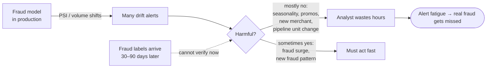
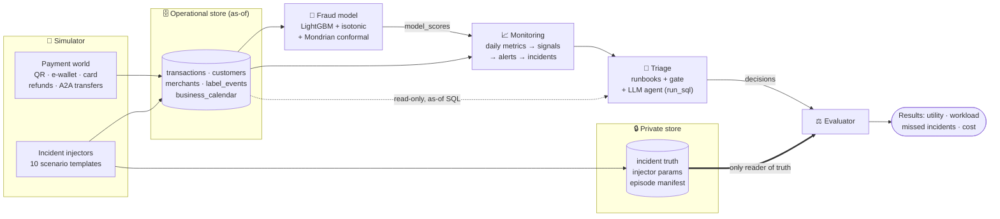
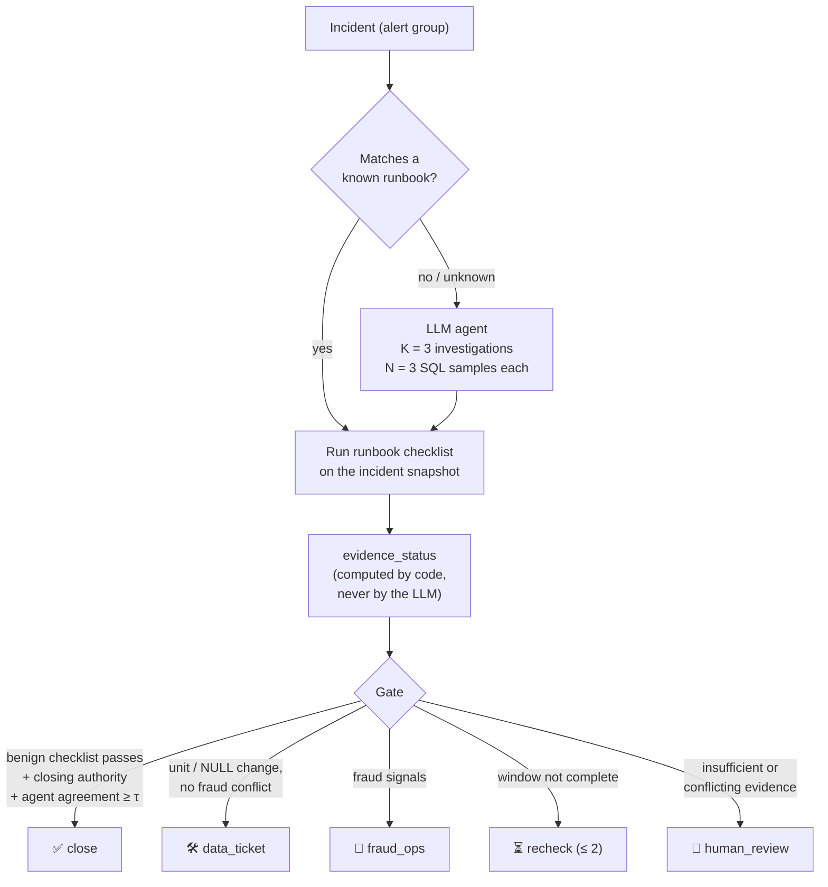
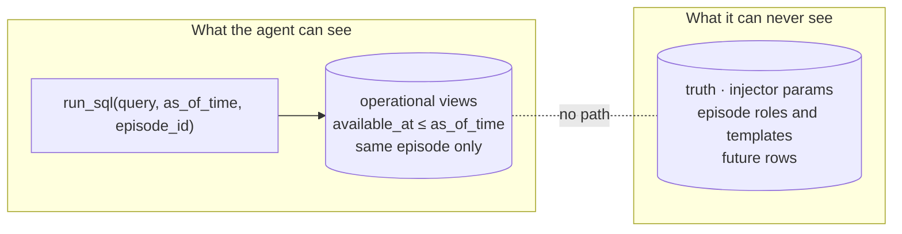
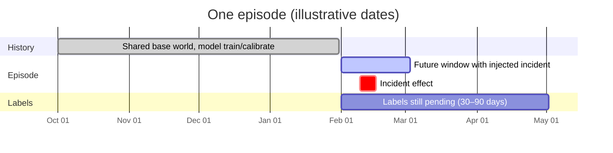
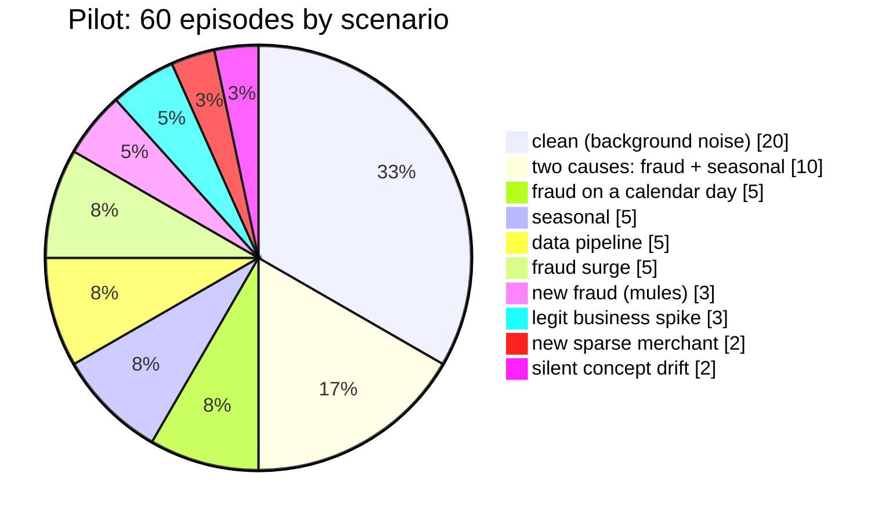
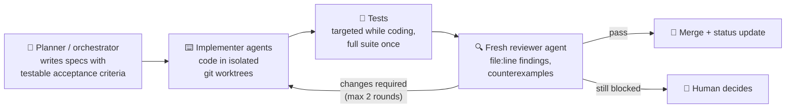

<div align="center">

# 🛡️ PayGuard

**Uncertainty-aware triage of fraud-model drift alerts when labels arrive late**


</div>

> **Research question.** Does a hybrid of code-based runbooks and an LLM investigation agent with
> uncertainty quantification resolve fraud-model drift alerts better than rules alone —
> **for which incident types, and at what cost?**

PayGuard answers that on a synthetic payment world where every incident has a known ground truth,
so both correct closures *and* missed or wrongly-closed incidents can be counted honestly.

> [!NOTE]
> **Status (Nov 2026): work in progress.** The full pipeline runs end to end on the smoke profile,
> and the 60-episode pilot benchmark is generated and validated. **No benchmark results are
> published yet** — they will come only from locked, held-out runs (see the Roadmap section).

---

## 📌 The problem



Drift detectors say *that* something changed. The hard, expensive step is deciding **why**, how
strong the evidence is, and **who should act**. PayGuard automates that step and measures it.

## 🏗️ Architecture



| Layer | Package | What it does |
|---|---|---|
| Simulator | `simulator/` | Synthetic payment world with `event_at` / `available_at` timestamps, 4-state delayed labels, a business calendar, and injected incidents. |
| Fraud model | `model/` | As-of features, LightGBM, isotonic calibration, Mondrian conformal prediction on raw scores; uncertain transactions go to human review. |
| Monitoring | `monitoring/` | Daily metrics, PSI and robust-baseline volume signals, alerts grouped into incidents (child incidents after a decision). |
| Triage | `triage/` | Four code-based runbooks with a gate; an LLM agent with a sandboxed `run_sql` tool investigates the rest. |
| Evaluation | `evaluation/` | Matches incidents to truth (`matched` / `ambiguous_match` / `unmatched`), scores decisions, reports support. |
| Harness | `payguard/` | One command per policy, with run-identity hashes, role locks and a persistent USD cost ledger. |

## 🧭 How an incident is triaged



Agent uncertainty is **black-box self-consistency**: `close_score = min(v_benign, min_sql_consistency)`,
where `v_benign` is the share of the 3 investigations concluding benign and SQL consistency is the
agreement between the results of 3 sampled queries. The agent may only close inside existing benign
runbooks; anything uncertain is escalated.

| Cause | Meaning | Candidate routing |
|---|---|---|
| `seasonal` | holiday, promotion, payday | benign → close via gate |
| `legit_business_change` | legitimate change with evidence | benign → close via gate |
| `no_material_change` | nothing material changed | benign → close via gate |
| `data_pipeline` | unit change, mass NULLs | `data_ticket` |
| `fraud_surge` | known fraud pattern spikes | `fraud_ops` |
| `new_fraud` | unseen pattern (e.g. social engineering via mule accounts) | `human_review` + retrain proposal |

## 🔒 Leakage-safe by construction



| Invariant | How it is enforced |
|---|---|
| **As-of everywhere** | Features and agent SQL only read rows with `available_at <= as_of_time` in the right episode; tests check that adding later data never changes an earlier answer. |
| **Truth isolation** | Truth lives in a separate private database; only the evaluator opens it. |
| **Pending ≠ negative** | Labels have four states; unresolved labels are never counted as legitimate. |
| **No tuning on test** | The episode manifest is locked before tuning; calibration/test analysis needs a recorded lock, and the harness refuses otherwise. |
| **Honest statistics** | Every error rate is reported with its denominator and an interval; a pilot is never presented as a near-zero-risk guarantee. |

## 🧪 Benchmark design

Episodes share one pre-T0 history and diverge after T0 under their own seeds.





Roles: **12 development / 24 calibration / 24 test**, split at episode level (a two-cause episode is
one unit). Calibration and test seeds are disjoint from the smoke profile.

- **Policies compared:** four baselines plus two agent variants (K = N = 1 vs. K = N = 3) on the same locked episodes.
- **Metrics:** utility, analyst workload, timely routing, missed incidents (including those monitoring never surfaced), wrong closures, and cost per incident, with episode-level bootstrap intervals.
- **Budget:** hard cap of **USD 10** for the whole benchmark, enforced by a persistent ledger.

## 🚀 Quickstart

Requires Python 3.12 and [uv](https://docs.astral.sh/uv/).

```bash
uv sync

# Generate and validate the smoke profile (5 episodes)
uv run python -m simulator generate --profile smoke --out data/smoke
uv run python -m simulator validate --run data/smoke

# End-to-end harness with the rule-only policy (no LLM calls)
export PAYGUARD_BENCHMARK_STATE_DIR="$(mktemp -d)"
uv run python -m payguard run --profile smoke --policy rule_human --out data/bench-smoke

# Tests
uv run pytest -q
```

<details>
<summary>Module CLIs</summary>

```bash
python -m simulator  {generate,validate}
python -m model      {train,score,evaluate}
python -m monitoring {metrics,signals,incidents}
python -m triage     {run,measure}
python -m evaluation {decisions,support}
python -m payguard   {run,lock}
```

Policies that call a real LLM (`rule_agent_openrouter_k1`) need `OPENROUTER_API_KEY` in `.env`;
every call is reserved against the persistent cost ledger before it is sent.

</details>

## 📊 Results

> [!IMPORTANT]
> **Pending.** Results will be filled in here only after calibration and test runs are locked,
> including negative results if the agent does not beat rules alone.

What has been measured so far is **cost**: on two development/calibration incidents, Qwen 3.7 Flash
via OpenRouter used ~3.5k tokens per call, which extrapolates to **≈ USD 0.0075 per agent-routed
incident** for the full design. This is an extrapolation, not a benchmark result.

## 🗺️ Roadmap

| Stage | Scope | Status |
|---|---|---|
| P0 | Research and protocol design | ✅ |
| P1 | Simulator, injectors, episodes, pilot-60 | ✅ |
| P2 | Fraud model: features, LightGBM, calibration, conformal | ✅ round 1 |
| P3 | Monitoring: metrics, signals, alerts, incidents | ✅ round 1 |
| P4 | Triage: runbooks, gate, `run_sql`, agent | 🔄 round 2 pending |
| P5 | Evaluation harness, matcher, support tables, cost ledger | 🔄 pilot harness in progress |
| P6 | FastAPI, Streamlit dashboard, Docker Compose, CI, demo video | ⬜ |

## 📚 Related work

PayGuard combines pieces that exist separately; the full annotated list is in
[docs/rationale.md](docs/rationale.md).

- **Fraud detection with delayed labels** — Dal Pozzolo et al., *Credit Card Fraud Detection: A Realistic Modeling and a Novel Learning Strategy* (IEEE TNNLS); Le Borgne et al., [*Fraud Detection Handbook*](https://github.com/Fraud-Detection-Handbook/fraud-detection-handbook).
- **Monitoring without labels** — Rabanser et al., [*Failing Loudly*](https://arxiv.org/abs/1810.11953) (NeurIPS 2019); NannyML [CBPE](https://nannyml.readthedocs.io/en/main/how_it_works/performance_estimation.html).
- **Conformal prediction and abstention** — Angelopoulos & Bates, [*A Gentle Introduction to Conformal Prediction*](https://arxiv.org/abs/2107.07511); Geifman & El-Yaniv, [*Selective Classification*](https://arxiv.org/abs/1705.08500); Angelopoulos et al., [*Learn then Test*](https://arxiv.org/abs/2110.01052).
- **Uncertainty for LLM agents** — Kirchhof et al., [*Position: UQ Needs Reassessment for LLM Agents*](https://arxiv.org/abs/2505.22655) (ICML 2025); Ren et al., [*Robots That Ask For Help (KnowNo)*](https://proceedings.mlr.press/v229/ren23a.html) (CoRL 2023).
- **Text-to-SQL confidence** — Maleki et al., [*Confidence Estimation for Text-to-SQL in LLMs*](https://arxiv.org/abs/2508.14056); [TrustSQL](https://arxiv.org/abs/2403.15879).
- **Agentic investigation and point-in-time data** — Yao et al., [*ReAct*](https://arxiv.org/abs/2210.03629); [Feast point-in-time joins](https://docs.feast.dev/getting-started/concepts/point-in-time-joins).

## ⚠️ Limitations

- The data is **synthetic**. That is what makes exact ground truth possible, but conclusions hold for the simulated world, not for any real payment network.
- 60 episodes is pilot-sized; intervals will be wide.
- The agent's closing authority is deliberately narrow (existing benign runbooks only).
- Not yet built: API service, dashboard, Docker demo, CI.

## 🗂️ Repository layout

```
simulator/    synthetic world, injectors, episodes, validation, support reports
model/        as-of features, LightGBM, calibration, conformal, scoring
monitoring/   daily metrics, signals, alerts, incidents
triage/       runbooks, gate, run_sql tool, LLM agent, measurement
evaluation/   truth matching, decision scoring, support tables
payguard/     benchmark harness, run identity, locks, cost ledger
configs/      YAML configuration (simulator, episodes, model, triage, LLM)
docs/         design documents (Vietnamese, one topic per file)
tests/        functional tests
review/       protocol checks (verify_plan_claims.py, check_links.py)
```

Design docs: [MASTER_PLAN.md](MASTER_PLAN.md) (status, roadmap, decision log) ·
[overview](docs/overview.md) · [data](docs/data.md) · [model](docs/model.md) ·
[monitoring](docs/monitoring.md) · [triage](docs/triage.md) · [evaluation](docs/evaluation.md) ·
[rationale](docs/rationale.md).

## 🤝 How it was built



Development used an AI-assisted multi-agent workflow, with a human making every scope, budget and
protocol decision. The coordination log, including each review outcome, is in
[docs/orchestration.md](docs/orchestration.md).
