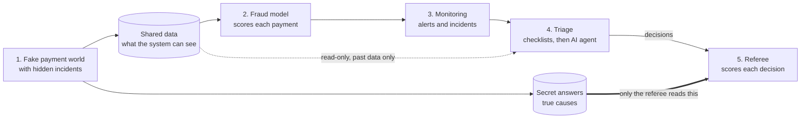
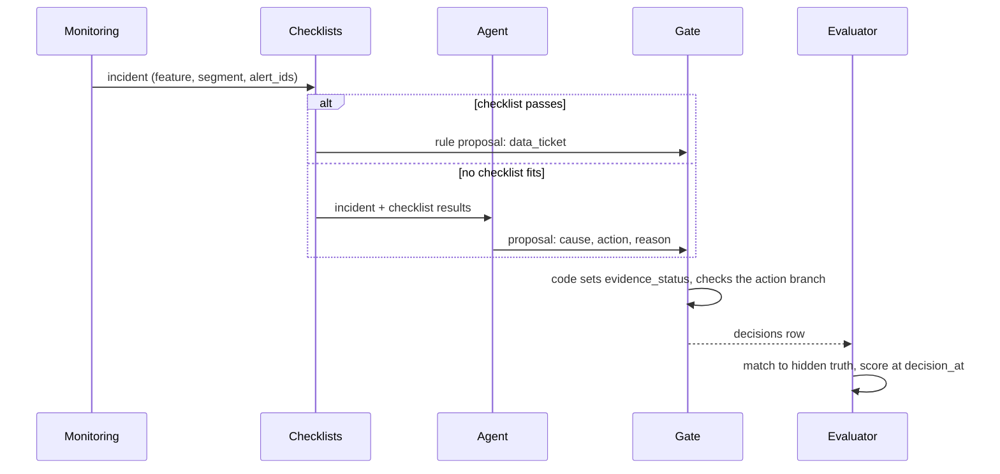

<div align="center">

# PayGuard

**Can rules plus an AI agent safely sort fraud-model alerts when the fraud labels arrive months late?**


</div>

## The problem

A payment company runs a fraud model. A monitoring system watches it and raises an **alert**
when the data starts to look different. Most of these alerts are harmless: a holiday, a
promotion, a big new merchant. A few are real: a fraud wave, or a broken data pipeline.

To tell them apart, an analyst spends hours on each alert. They cannot simply check the fraud
labels, because those arrive **30–90 days later** (chargebacks and reports take time). So teams
get tired of alerts, start to ignore them, and miss the real ones. This is called *alert fatigue*.

## What PayGuard does

PayGuard is a **test bench** for this problem. It answers one question with numbers:

> Does "rules + an AI investigation agent" handle drift alerts better than rules alone? For which
> kinds of incidents, and at what cost?

1. It **builds a fake payment world** where we secretly know the true cause of every problem.
2. It **runs a real pipeline** on that world: fraud model → monitoring → alerts.
3. It **sorts each alert** with code-based checklists first, then an AI agent for the rest. Each
   alert ends in one action: close it, check again later, open a data ticket, send it to the
   fraud team, or send it to a human.
4. A separate **referee** (the evaluator), the only part that can see the secret answers, counts
   right and wrong decisions, including real problems that were wrongly closed or never raised.

> [!NOTE]
> **Status (November 2026): work in progress, no benchmark results yet.** The full pipeline runs
> end to end on 60 test worlds. After a scale fix, monitoring now catches 7 of 10 hidden causes on
> development episodes (was 1 of 10). The agent itself has not been run with a real LLM at scale yet.
> See [Status](#status-and-honest-findings).

## How it works



| Step | Folder | In plain words |
|---|---|---|
| 1. Simulator | `simulator/` | Makes payments (QR, e-wallet, card, bank transfer), fraud patterns, late labels, and a public holiday/promotion calendar. Creates many "parallel worlds" (episodes; 60 in the pilot); each hides 0–2 incidents. |
| 2. Fraud model | `model/` | A standard fraud classifier (LightGBM). Payments it is unsure about go to review. |
| 3. Monitoring | `monitoring/` | Checks daily statistics. When something changes too much, it raises an alert and groups related alerts into one **incident**. |
| 4. Triage | `triage/` | Code checklists ("runbooks") handle known cases. The AI agent investigates the rest with one read-only SQL tool. A code **gate** decides if the proposed action is allowed. |
| 5. Evaluator | `evaluation/` | Matches each incident to the hidden truth and scores every decision. |
| Harness | `payguard/` | Runs steps 1–5 with one command, on a fresh copy of the data. |

**The key safety idea:** the agent may never see the future or the answers. Every tool reads
only data that was available at decision time, and the secret answers live in a separate
database that only the evaluator opens. More in [How the test is kept fair](#how-the-test-is-kept-fair).

## Quickstart

You need Python 3.12 and [uv](https://docs.astral.sh/uv/). No API key is needed.

```bash
uv sync

# 1. Generate and check the small "smoke" world (5 episodes)
uv run python -m simulator generate --profile smoke --out data/p1-smoke
uv run python -m simulator validate --run data/p1-smoke

# 2. Run the whole pipeline with a fake, offline agent (no network calls).
#    The state folder (cost ledger, locks) must be outside --out;
#    by default it is ~/.payguard-benchmark.
export PAYGUARD_BENCHMARK_STATE_DIR="$(mktemp -d)"
uv run python -m payguard run --profile smoke --policy rule_agent_fake --out data/bench-smoke

# 3. Tests (the full suite takes several minutes)
uv run pytest -q
```

Step 2 builds its own data under `--out`, trains the model, runs monitoring and triage, and
writes the evaluator report to `<out>/base/private/reports/p5_1/<policy>/decisions.json`.
It only scores **development** episodes by default. In the smoke world the only development
episode is a clean one with no alerts, so expect `decisions=0` and empty metrics (shown as
`null`). For a real workload use `--profile pilot` (60 episodes, about an hour).

<details>
<summary>Policies, single-step commands and the optional real LLM</summary>

| Policy (`--policy`) | How alerts are sorted |
|---|---|
| `rule_human` | checklists only; everything else goes to a human |
| `rule_agent_fake` | checklists + a fixed fake agent (always asks for a human) |
| `rule_agent_openrouter_k1` | checklists + a real LLM agent, one attempt; **optional**, needs an API key |

The real-LLM policy reads `OPENROUTER_API_KEY` from the environment or from a `.env` file at the
repository root (git-ignored; never commit it). Every call is booked in a cost ledger before it
is sent, and the run stops at the configured spending cap.

Each step can also run on its own (`--help` lists the options):

```bash
uv run python -m simulator  {generate,validate}
uv run python -m model      {train,score,evaluate}
uv run python -m monitoring {metrics,signals,incidents}
uv run python -m triage     {run,measure}
uv run python -m evaluation {decisions,support}
uv run python -m payguard   {run,lock,forecast-cost}  # lock {prompt-rule,policy}; forecast-cost: docs/p5-implementation.md, P5.0d
```

Outside the harness, commands that read the hidden truth only accept development episodes.

</details>

## Status and honest findings

| Stage | Scope | Status |
|---|---|---|
| P0 | Research and test design | done |
| P1 | Simulator, incidents, 60-episode pilot | done (round 2) |
| P2 | Fraud model | round 1 done |
| P3 | Monitoring | round 1 done |
| P4 | Checklists, gate, SQL tool, agent | round 1 done; round 2 (all checklists, full agent) pending |
| P5 | Harness, evaluator, cost ledger | runs on the pilot; result tables pending |
| P6 | API, dashboard, Docker, CI, demo | not started |

**What works.** `payguard run --profile pilot` finishes on all 60 episodes with the rule-only and
fake-agent policies. Calibration and test episodes have **not** been looked at yet.

**Development results so far** (12 development episodes with 10 hidden causes;
[notes](docs/p5-implementation.md), Vietnamese). These are in-sample numbers on the episodes used
for tuning, not benchmark results:

| Run | Hidden causes caught | Needing action caught | Alerts / incidents | Incidents reaching the agent |
|---|---|---|---|---|
| First run (03/11) | 1 of 10 | 1 of 6 | 22 / 22, all in one episode | 22 |
| After scale fix (04/11) | 7 of 10 | 5 of 6 | 45 / 45, in 6 episodes | 43 |

- **Why the first run failed: scale mismatch.** Incident sizes and alert thresholds were tuned on
  the small smoke world (about 4 payments a day), but the pilot has about 174 a day. A fraud surge
  of 9 payments was about 5% of a pilot day, and the public calendar promised a much bigger
  seasonal effect than the one injected.
- **The fix.** Injected volume effects are now relative to each world's normal volume (seasonal
  +100% on its channel, fraud surge +50% of a day), the calendar states the real effect, and
  thresholds are set per profile on clean development episodes only (pilot: volume 0.21, PSI 0.01).
  The locked episode list did not change. The 4 clean development episodes raised no alerts.
- **Still missed:** `new_fraud` (needs receiver-side signals), one single-cause seasonal episode,
  and the legitimate business spike (its injection was left unscaled on purpose). Short fraud
  bursts and receiver signals are left for monitoring round 2 and reported as negative results.
- **Known risk:** the pilot PSI threshold sits only about 2% above the largest clean value seen,
  so held-out clean episodes may raise some false alarms. This will be measured, not tuned away.
- The only checklist allowed to close harmless incidents (`seasonal_calendar`) is not built yet.

**Next steps:** a tiny real-LLM cost check on 1–2 incidents (needs approval), agent round 2
(SQL fixes, `seasonal_calendar` checklist), a report shell, then lock prompts and rules before
calibration and test. Decisions are logged in [MASTER_PLAN.md](MASTER_PLAN.md) (Vietnamese).

## A worked example

This follows one incident from alert to score.

**What the smoke run gives.** We ran the Quickstart commands. The smoke world has one
development episode, `ep-0001`, and it is *clean* (no hidden incident). Monitoring raised
**0 alerts** there, so there were **0 incidents** and **0 decisions**. The evaluator report has
`truth_counts.total = 0` and every rate is `null` (no denominator), never `0%`. That is the
correct result for a clean world, but it gives nothing to trace. Smoke alerts exist only in
calibration and test episodes, which are off limits for tuning and examples.

So the trace below uses the **real field names and rules** from the code and
[docs/data.md](docs/data.md), with **illustrative values** (not measured).



<details>
<summary>Step-by-step trace (illustrative values)</summary>

1. **Hidden incident.** In a `data_pipeline` world, a bug multiplies payment amounts by 100 from
   one day on. The private truth row says `cause = data_pipeline`, `requires_intervention = 1`,
   `accepted_actions = ["data_ticket", "human_review"]`, and a `deadline_at` 7 days after the
   effect is first visible.
2. **Alert.** The daily job compares this week's `amount_avg_7d` distribution with the
   reference period. PSI goes above 0.25, so it writes an `alerts` row: `metric`, `feature`,
   `segment`, `value`, `reference`, `threshold`, `as_of_time`.
3. **Incident.** No incident on that feature and segment is open, so a new `incidents` row is
   created with `alert_ids_json = [<alert_id>]`. Later alerts within 2 days join it.
4. **Checklist.** `unit_or_null_change` compares the median amount before and after the change.
   A ratio within ×/÷2 of 100 (also of 1/100 or 1000) counts as a unit change. Both days need at least
   `n_min = 2` payments. A separate `fraud_signal` check looks for fraud-side signals in the same
   segment. Each result has `status`, `reason`, `scope_match`, `window_complete`,
   `requires_human_review` and `details`.
5. **Proposal.** The checklist passed, so the rule proposes
   `{cause: data_pipeline, runbook: unit_or_null_change, action: data_ticket}`. If it had not
   passed, the agent would run one `run_sql` query on a past-only snapshot and return a JSON
   proposal with `cause`, `action`, `reason` (and maybe `runbook`). The fake agent always returns
   `{cause: other, runbook: null, action: human_review}`.
6. **Gate.** Code, not the LLM, sets `evidence_status = sufficient`. The `data_ticket` branch
   needs a passed unit check and no fraud conflict; it does not need a benign verdict or a
   confidence score. A `decisions` row is written with `decision_at = as_of_time`, the
   checklist results, `tool_trace_ids_json`, `policy_version` and token cost.
7. **Score.** The evaluator matches the incident to the truth by time, segment and feature
   (`matched`). The action is in `accepted_actions` and
   `intervention_start_at <= decision_at <= deadline_at`, so it counts for **timely routing
   recall**. Had the incident been closed, it would count as an **unsafe closure** of that
   truth.

</details>

## How the test is kept fair

| Rule | How it is enforced | Why it matters |
|---|---|---|
| **No peeking at the future** | Every read is "as of" a time: only rows with `available_at <= as_of_time` in the same episode. Tests check that adding later data never changes an earlier answer. | A decision cannot use information it would not have had. |
| **Answers are hidden** | Truth lives in a separate private database; only the evaluator opens it. | The agent cannot look up the answer. |
| **Unknown is not "legit"** | Labels have four states; `pending` is never counted as a legitimate payment. | Late fraud is not silently counted as clean. |
| **Locked split** | Episodes are split 12 development / 24 calibration / 24 test before any tuning. | The split cannot be reshuffled to look better. |
| **No tuning on test** | Rules and prompts are tuned on development, close permissions on calibration; test runs once. | Reported numbers are out-of-sample. |
| **Tamper checks** | Runs are keyed by content hashes of code, configs, prompts and model files; held-out runs need a matching lock. | A change after the lock is detected and refused. |
| **Evidence by code** | `evidence_status` comes from checklist code, not from the LLM. | The model cannot talk its way into closing an alert. |

## Design decisions

| Decision | Rejected alternative | Why |
|---|---|---|
| Rules first, agent second; "rules + human" is the main baseline | Agent-first triage | The goal is to measure honestly where an agent adds value over rules, not to assume it does. |
| Synthetic world with injected incidents | Public fraud datasets only | Only a simulator gives the exact cause, start time and deadline of every incident. |
| Unlabeled (`pending`) payments are not negatives | Treat "no report yet" as legit | Labels arrive late; counting them as legit hides recent fraud. |
| Score each decision with the truth known at its `decision_at` | Score with the final labels | A correct early close would be punished for fraud that only started later. |
| Main risk metric counts each true incident once (unsafe truth rate) | Wrong closures per incident | Incident counts depend on how a policy splits cases (1/7 vs 1/3 for the same mistake). |
| Separate close permission for rules and for the agent | One shared confidence threshold | One bad checklist would switch off closing for the whole system. |
| Agent confidence from agreement across repeated runs (black-box) | Token probabilities or self-reported confidence | Works without special API features; token probabilities stay as a comparison baseline. |
| Seasonal check looks at *which day* moved and *by how much* | "Event covers ≥ 50% of the window" | A one-day event covers at most 1/7 ≈ 14% of a 7-day window, so that rule would reject every one-day event. |
| Unit-change band ×/÷2 around 100 | ±5% | With few payments per day, normal daily medians already swing about 2×. |

Sources: [docs/rationale.md](docs/rationale.md) and the decision log in
[MASTER_PLAN.md §7](MASTER_PLAN.md#7-nhật-ký-quyết-định) (both Vietnamese).

<details>
<summary><b>Technical details</b>: scenarios, model, monitoring, triage, evaluation</summary>

### Episodes and scenarios

All episodes share one history before T0 = 2026-02-01. After T0, each episode regenerates 30 days
under its own seed and injects 0–2 incidents.

| Scenario | dev | cal | test | Expected handling |
|---|---:|---:|---:|---|
| clean | 4 | 8 | 8 | no action |
| two causes: fraud + seasonal | 2 | 4 | 4 | human review |
| fraud on a calendar day | 1 | 2 | 2 | fraud ops |
| seasonal | 1 | 2 | 2 | benign, close only through the gate |
| `data_pipeline` (amount ×100, mass NULLs) | 1 | 2 | 2 | data ticket |
| `fraud_surge` | 1 | 2 | 2 | fraud ops |
| `new_fraud` (social engineering via mules) | 1 | 1 | 1 | human review + retrain proposal |
| `legit_business_spike` | 1 | 1 | 1 | benign; human review (no benign runbook) |
| new sparse merchant | 0 | 1 | 1 | no material change; must not auto-close |
| silent concept drift | 0 | 1 | 1 | hard case |
| **Total** | **12** | **24** | **24** | |

The mix is chosen to test hard cases, not to match real life, so results are always reported
per group. Source: [data.md §4](docs/data.md#4-episode--thế-giới-song-song).

### Fraud model

- Three time-based splits: fit (Jul–Sep 2025), validation (late Sep), calibration (Oct). Every
  label cohort is at least 90 days old at T0.
- Isotonic calibration turns scores into readable probabilities. Class-wise (Mondrian)
  conformal sets are computed on the **raw** score, so their coverage does not depend on the
  calibrator; α_legit = 0.005 and α_fraud = 0.20 are starting values. Empty or two-label sets
  go to review.

### Monitoring (round 1)

| Stage | Implemented now |
|---|---|
| Metrics | PSI with 2 quantile bins on `txn_count_24h` and `amount_avg_7d` (7-day window); daily volume against a reference median; model review rate (computed, no signal yet) |
| Signals | PSI > 0.25; volume residual against the calendar's expected change > 4.25 |
| Incidents | Alerts on the same feature/segment within 2 days of an open incident are merged; after a final decision they open a child incident |

KS tests, Benjamini–Hochberg and CBPE are designed but not built yet. Values:
[`configs/monitoring.yaml`](configs/monitoring.yaml).

### Triage

| Component | Design (MVP) | Implemented now (round 1) |
|---|---|---|
| Runbooks | 4 code checklists: `seasonal_calendar`, `unit_or_null_change`, `small_sample`, `segment_concentration` | `unit_or_null_change` → `data_ticket`, with a `small_sample` guard (`n_min = 2`) |
| `evidence_status` | `sufficient` / `insufficient` / `conflicting`, computed by code | same |
| Gate | separate branches for close, routing, recheck (≤ 2, ≥ 24 h apart) and human review | same; no runbook can close yet |
| Agent | K = 3 investigations, N = 3 SQL samples each, `close_score = min(v_benign, min_sql_consistency)`, `tau_agent ∈ {2/3, 1}` chosen on calibration | one `run_sql` + one JSON proposal; the agent can never close |
| `run_sql` | read-only SQL on an as-of snapshot of one episode | same; schema `asof` only, timeouts, row and byte limits |
| LLM | Qwen 3.7 Flash via OpenRouter | a fake offline provider and a real OpenRouter provider |

`v_benign` is the share of the 3 investigations that conclude "harmless"; SQL consistency is how
often 3 sampled queries give the same result. The agent may close only inside an existing benign
runbook; anything uncertain goes to a human.

### Evaluation

- **Matcher.** Each incident is `matched`, `ambiguous_match` or `unmatched` to the truth by time
  (metric window + feature lookback), segment and feature. Unmatched never counts as benign.
- **Main risk metric.** Unsafe truth rate: true incidents that needed action and were wrongly
  closed at least once, divided by all true incidents that needed action.
- **Also reported.** Detection recall, timely routing recall (deadline D = 7 days), benign
  automation, workload, cost; confidence intervals by resampling whole episodes.
- **Policies compared.** Rules + human (main baseline), rules + agent without confidence gate,
  rules + agent with it, always human; plus two agent ablations (gate on/off; K = N = 1 vs 3).

</details>

## Glossary

| Term | Meaning |
|---|---|
| **Episode** | One simulated 30-day "parallel world" after T0, with its own seed and 0–2 hidden incidents. |
| **As-of time** (`as_of_time`) | The moment a decision is made. Everything must be computed from data visible at that moment. |
| **`available_at`** | When a row becomes visible to the system (it can be later than `event_at`, when it happened). |
| **Truth** | The hidden record of what was injected: cause, timing, accepted actions. Only the evaluator reads it. |
| **Alert vs incident** | An alert is one threshold crossing on one day. An incident groups related alerts and is the unit that gets a decision. |
| **Runbook** | A code checklist for one known situation, e.g. "amounts jumped ×100 → data ticket". |
| **Gate** | Code that checks whether a proposed action is allowed, with separate rules for close, routing, recheck and human review. |
| **`evidence_status`** | `sufficient`, `insufficient` or `conflicting`, computed by code from checklist results. |
| **Pending label** | A payment whose outcome is not known yet. It is not counted as legit. |
| **Conformal set** | For each payment, the set of labels (fraud, legit) the model cannot rule out at a chosen error rate. One label = confident; empty or both = send to review. |
| **Self-consistency K/N** | Run the agent's investigation K times and each SQL query N times; agreement between runs is the confidence score. |
| **PSI** | Population Stability Index: a number for how much a distribution changed compared with a reference period. |

## Limitations

- **Synthetic data.** It gives exact answers, but conclusions apply to the simulated world, not
  to a real payment network.
- **Small pilot.** With 60 episodes (about 16 with incidents in test), intervals will be wide and
  per-type comparisons weak. A pilot is never presented as a near-zero-risk guarantee.
- **Narrow close permission.** The agent may close only inside existing benign runbooks. A correct
  "harmless" diagnosis without a runbook still goes to a human.
- **Monitoring sensitivity.** Not yet good enough at pilot scale (see [Status](#status-and-honest-findings)).
- **Not built yet.** Triage round 2, result tables, API, dashboard, Docker demo, CI.

## Repository layout and docs

```
simulator/    synthetic payment world, incidents, episodes, labels, validation
model/        as-of features, LightGBM, calibration, conformal sets, scoring
monitoring/   daily metrics, signals, alerts, incidents
triage/       runbooks, gate, run_sql tool, LLM agent, cost ledger
evaluation/   truth matcher, decision scoring, detection recall, development support
payguard/     end-to-end harness, run identity, locks
configs/      YAML settings with their sources
docs/         design docs, one topic per file (Vietnamese)
tests/        functional tests (pytest)
review/       protocol checks: verify_plan_claims.py, check_links.py
```

The design docs are in Vietnamese. **[docs/README.md](docs/README.md)** is an English map of
what each file covers. Start with [MASTER_PLAN.md](MASTER_PLAN.md) (status, roadmap, decision log).

## Related work

PayGuard combines existing methods; it does not claim a new one. Its aim is to measure honestly
where an agent helps compared with rules. Annotated list: [docs/rationale.md](docs/rationale.md).

| Topic | References | Used for |
|---|---|---|
| Fraud detection with late labels | Dal Pozzolo et al., [*Credit Card Fraud Detection: A Realistic Modeling and a Novel Learning Strategy*](https://boracchi.faculty.polimi.it/docs/2017_FraudsTNNLS.pdf) (IEEE TNNLS 2017); Le Borgne et al., [*Fraud Detection Handbook*](https://github.com/Fraud-Detection-Handbook/fraud-detection-handbook) | label snapshots; simulator design (rewritten) |
| Monitoring without labels | Rabanser et al., [*Failing Loudly*](https://arxiv.org/abs/1810.11953) (NeurIPS 2019); NannyML [CBPE](https://nannyml.readthedocs.io/en/main/how_it_works/performance_estimation.html) | drift signals; CBPE baseline (planned) |
| Conformal prediction and abstention | Angelopoulos & Bates, [*A Gentle Introduction to Conformal Prediction*](https://arxiv.org/abs/2107.07511); Geifman & El-Yaniv, [*Selective Classification*](https://arxiv.org/abs/1705.08500); Angelopoulos et al., [*Learn then Test*](https://arxiv.org/abs/2110.01052) | conformal sets; risk on the closed subset; tune on calibration, test held out |
| Uncertainty for LLM agents | Kirchhof et al., [*Position: UQ Needs Reassessment for LLM Agents*](https://arxiv.org/abs/2505.22655) (ICML 2025); Ren et al., [*Robots That Ask For Help (KnowNo)*](https://proceedings.mlr.press/v229/ren23a.html) (CoRL 2023) | black-box self-consistency; conformal agent as an extension |
| Text-to-SQL confidence | Maleki et al., [*Confidence Estimation for Text-to-SQL in LLMs*](https://arxiv.org/abs/2508.14056); [TrustSQL](https://arxiv.org/abs/2403.15879); Zhong et al., [test-suite evaluation](https://aclanthology.org/2020.emnlp-main.29/) (EMNLP 2020) | execution consistency for `run_sql`; counterexample DBs |
| Agents and point-in-time data | Yao et al., [*ReAct*](https://arxiv.org/abs/2210.03629); [Feast point-in-time joins](https://docs.feast.dev/getting-started/concepts/point-in-time-joins) | agent loop; as-of contract |

## How it was built

Development used an AI-assisted multi-agent workflow. A human made every scope, protocol and
threshold decision.

| Role | Who | Responsibility |
|---|---|---|
| Planner / orchestrator | Claude Opus (Claude Code) | Writes task specs with testable acceptance criteria, dispatches work, merges, keeps status |
| Implementers | Codex `gpt-6-luna`; Claude Haiku 5.5 for small tasks | Code and tests, each task in its own git worktree |
| Reviewer | A fresh Claude Opus 5.5 sub-agent per review | Read-only review with `file:line` findings; at most 2 rounds, then the human decides |

Rules for every agent are in [AGENTS.md](AGENTS.md); the coordination log is in
[docs/orchestration.md](docs/orchestration.md) (Vietnamese).

## License

No license file has been added yet.
