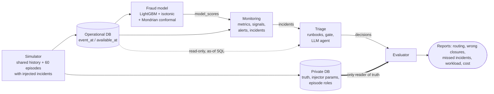

<div align="center">

# PayGuard

**A leakage-safe benchmark for triaging fraud-model drift alerts when fraud labels arrive 30–90 days late**


</div>

> **Research question.** Does a hybrid of code-based runbooks and an LLM investigation agent with
> uncertainty quantification resolve fraud-model drift alerts better than rules alone, for which
> incident types, and at what cost?

> [!NOTE]
> **Status (November 2026): work in progress, no benchmark results yet.** The pipeline runs end to
> end on the 60-episode pilot. Development runs show that monitoring is not yet sensitive enough
> (see [Current status](#current-status-and-honest-findings)). Results will be published only from
> locked, held-out runs, including negative results.

## In 30 seconds

- **The problem.** A production fraud model raises many drift alerts. Most are harmless: holidays,
  promotions, a new large merchant. Fraud labels take 30–90 days to arrive, so nobody can check
  an alert right away, and each investigation costs an analyst hours. Teams start to ignore alerts
  and miss the real ones.
- **What PayGuard does.** It turns each alert into an incident, checks it with code-based runbooks,
  sends the rest to an LLM agent with a read-only, point-in-time SQL tool, and routes each
  incident to `close`, `recheck`, `data_ticket`, `fraud_ops` or `human_review`.
- **How it is measured.** Every incident comes from a synthetic payment world with a known
  injected cause. An isolated evaluator counts correct closures, wrong closures and incidents
  that monitoring never raised.
- **Why it is hard.** Ground truth is late, benign and harmful causes can overlap in time (fraud
  on a holiday), and any leak of future data or truth into the agent would make the results
  meaningless.

## Overview



One command (`python -m payguard run`) runs the whole chain for one policy on an isolated copy
of the data.

## How it works

| Layer | Package | What it does | Design doc |
|---|---|---|---|
| Simulator | `simulator/` | Payment world (QR, e-wallet, card, A2A transfers, refunds); card testing, account takeover, collusion, social engineering with mule cash-out; 4-state delayed labels; public `business_calendar`; 60 parallel episodes | [data](docs/data.md) |
| Fraud model | `model/` | As-of features, deterministic LightGBM, isotonic calibration, Mondrian conformal sets on the raw score (uncertain transactions go to review) | [model](docs/model.md) |
| Monitoring | `monitoring/` | Daily metrics, then signals, then alerts, grouped into incidents; a new alert after a final decision creates a child incident | [monitoring](docs/monitoring.md) |
| Triage | `triage/` | Runbook checklists in code, an action gate, and an LLM agent with a sandboxed `run_sql` tool | [triage](docs/triage.md) |
| Evaluation | `evaluation/` | Matches incidents to truth, scores each decision at its own `decision_at`, reports development support | [evaluation](docs/evaluation.md) |
| Harness | `payguard/` | Runs a policy end to end, with content-hash run identity, role locks and a persistent cost ledger | [p5 sub-plan](docs/p5-implementation.md) |

All design docs are in Vietnamese.

### Simulator and episodes

All episodes share one history before T0 = 2026-02-01. After T0, each episode regenerates 30 days
under its own seed and injects 0–2 incidents. Each transaction has an `event_at` (when it
happened) and an `available_at` (when the system can see it). Labels are `pending` until resolved.

| Scenario | dev | cal | test | Expected handling |
|---|---:|---:|---:|---|
| clean | 4 | 8 | 8 | no action |
| two causes: fraud + seasonal | 2 | 4 | 4 | human review |
| fraud on a calendar day | 1 | 2 | 2 | fraud ops |
| seasonal | 1 | 2 | 2 | benign, close only through the gate |
| `data_pipeline` (amount ×100, mass NULLs) | 1 | 2 | 2 | data ticket |
| `fraud_surge` | 1 | 2 | 2 | fraud ops |
| `new_fraud` (social engineering via mules) | 1 | 1 | 1 | human review + retrain proposal |
| `legit_business_spike` | 1 | 1 | 1 | benign; human review (no benign runbook) |
| new sparse merchant | 0 | 1 | 1 | no material change; must not auto-close |
| silent concept drift | 0 | 1 | 1 | hard case |
| **Total** | **12** | **24** | **24** | |

The mix is chosen to test hard cases. It does not match a natural distribution, so results are
always reported per group. Source: [data.md §4](docs/data.md#4-episode--thế-giới-song-song).

### Fraud model

- Three time-based splits: fit (Jul–Sep 2025), validation (late Sep), calibration (Oct). Every
  label cohort is at least 90 days old at T0.
- Isotonic calibration gives readable probabilities. The class-conditional (Mondrian) conformal
  sets are computed on the **raw** score, with α_legit = 0.005 and α_fraud = 0.20 as starting
  values. Empty or two-label sets go to review.

### Monitoring

| Stage | Implemented now (round 1) |
|---|---|
| Metrics | PSI with 2 quantile bins on `txn_count_24h` and `amount_avg_7d` (7-day window); daily volume against a reference median; model review rate (computed, no signal yet) |
| Signals | PSI > 0.25; volume residual against the calendar's expected change > 4.25 |
| Incidents | Alerts on the same feature/segment within 2 days of an open incident are merged; after a final decision they open a child incident |

KS tests, Benjamini–Hochberg and CBPE (label-free performance estimation) are in the design but
not implemented yet. Values: [`configs/monitoring.yaml`](configs/monitoring.yaml).

### Triage

| Component | Design (MVP) | Implemented now (round 1) |
|---|---|---|
| Runbooks | 4 code checklists: `seasonal_calendar`, `unit_or_null_change`, `small_sample`, `segment_concentration` | `unit_or_null_change` → `data_ticket`, with a `small_sample` guard (`n_min = 2`) |
| `evidence_status` | `sufficient` / `insufficient` / `conflicting`, **computed by code from tool output, never by the LLM** | same |
| Gate | separate branches for close, routing, recheck (≤ 2, ≥ 24 h apart) and human review | same; no runbook has close authority yet |
| Agent | K = 3 investigations, N = 3 SQL samples each, `close_score = min(v_benign, min_sql_consistency)`, `tau_agent ∈ {2/3, 1}` chosen on calibration | one `run_sql` + one JSON proposal, no UQ; the agent can never close |
| `run_sql` | read-only SQL on an as-of snapshot of one episode | same; schema `asof` only, timeouts, row and byte limits |
| LLM | Qwen 3.7 Flash via OpenRouter | a deterministic fake provider for tests and a real OpenRouter provider |

Agent uncertainty is black-box self-consistency: `v_benign` is the share of the 3 investigations
that conclude benign, and SQL consistency is the agreement between the results of 3 sampled
queries. The agent may close only inside an existing benign runbook. Anything uncertain is
escalated.

### Evaluation

- **Matcher.** Each incident is `matched`, `ambiguous_match` or `unmatched` to injected truth,
  using time (metric window + feature lookback), segment and feature. Unmatched never counts as benign.
- **Decision-time scoring.** A decision is judged only against truth already effective at its
  `decision_at`, so a correct early closure is not penalised for fraud that starts later.
- **Primary risk metric.** Unsafe truth rate: required-intervention incidents with at least one
  wrong closure, divided by all required-intervention incidents on a fixed truth set.
- **Also reported.** Detection recall, timely routing recall (correct action within the deadline,
  D = 7 days), benign automation, workload, cost, with episode-level bootstrap intervals.
- **Policies.** Rule + human (main baseline), rule + agent without UQ, rule + agent with UQ, always
  human; plus two agent ablations (UQ gate on/off; K = N = 1 vs K = N = 3).

## Leakage-safe benchmark design

| Rule | How it is enforced | Why it matters |
|---|---|---|
| **As-of reads** | Features, metrics and agent SQL read only rows with `available_at <= as_of_time` in the same `episode_id`; tests check that later data never changes an earlier answer | No decision can use information from the future |
| **Truth isolation** | Truth and injector parameters live in a separate private DB; only the evaluator opens it | The agent cannot look up the answer |
| **Pending ≠ negative** | Labels have four states; unresolved labels are never treated as legitimate | Late fraud is not silently counted as clean |
| **Locked manifest 12/24/24** | Episode roles are fixed at episode level before tuning; calibration/test seeds are disjoint from smoke seeds | The split cannot be reshuffled to look better |
| **No tuning on test** | Rules, prompts and thresholds are tuned on development; close authority and `tau_agent` on calibration; test runs once | Reported numbers are out-of-sample |
| **Identity hashes and locks** | Runs are keyed by content hashes of code, configs, prompts, sampling and model artifacts; calibration/test analysis requires a matching lock | A change after the lock is detected and refused |
| **Evidence computed by code** | `evidence_status` comes from checklist code, not from the LLM | The model cannot talk its way into a closure |

## Quickstart

Requires Python 3.12 and [uv](https://docs.astral.sh/uv/). No API key is needed.

```bash
uv sync

# Generate and validate the smoke profile (5 episodes)
uv run python -m simulator generate --profile smoke --out data/p1-smoke
uv run python -m simulator validate --run data/p1-smoke

# End-to-end harness with the deterministic fake agent (no network calls).
# The shared state dir (cost ledger, role locks) must be outside the benchmark root;
# it defaults to ~/.payguard-benchmark.
export PAYGUARD_BENCHMARK_STATE_DIR="$(mktemp -d)"
uv run python -m payguard run --profile smoke --policy rule_agent_fake --out data/bench-smoke

# Tests (full suite takes several minutes)
uv run pytest -q
```

The harness generates its own data under `--out`, trains the model, runs monitoring and triage,
and writes the evaluator report under `<out>/base/private/reports/`. `--profile pilot` runs the
60-episode pilot and takes about an hour.

<details>
<summary>Policies and module CLIs</summary>

| Policy (`--policy`) | Triage |
|---|---|
| `rule_human` | runbooks only; anything else goes to human review |
| `rule_agent_fake` | runbooks + deterministic fake agent |
| `rule_agent_openrouter_k1` | runbooks + real LLM agent (K = 1); **optional**, needs an API key |

The real-LLM policy reads `OPENROUTER_API_KEY` from the environment or from a `.env` file at the
repository root (git-ignored; never commit it). Every call is reserved against the persistent
cost ledger before it is sent, and the harness refuses to exceed the configured cap.

Each stage can also be run on its own (`--help` lists the options):

```bash
python -m simulator  {generate,validate}
python -m model      {train,score,evaluate}
python -m monitoring {metrics,signals,incidents}
python -m triage     {run,measure}
python -m evaluation {decisions,support}
python -m payguard   {run,lock}           # lock {prompt-rule,policy}
```

Outside the harness, commands that read truth only accept development episodes.

</details>

## Current status and honest findings

| Stage | Scope | Status |
|---|---|---|
| P0 | Research and protocol design | done |
| P1 | Simulator, injectors, episodes, 60-episode pilot | done (round 2) |
| P2 | Features, LightGBM, calibration, conformal | round 1 done |
| P3 | Metrics, signals, alerts, incidents | round 1 done |
| P4 | Runbooks, gate, `run_sql`, agent | round 1 done; round 2 (full runbooks, K = N = 3 UQ) pending |
| P5 | Harness, matcher, support tables, cost ledger | harness runs on pilot; report tables pending |
| P6 | API, dashboard, Docker Compose, CI, demo | not started |

**What works.** `payguard run --profile pilot` completes end to end on all 60 episodes with the
rule-only and fake-agent policies. Calibration and test episodes have not been analysed.

**What the first development run showed** (12 development episodes, 10 injected truths;
[P5.0b notes](docs/p5-implementation.md), Vietnamese):

- Monitoring detected **1 of 10** injected causes. All 22 alerts came from the single
  `data_pipeline` episode, and each alert became its own incident. `fraud_surge`, `seasonal`,
  `new_fraud` and `legit_business_spike` raised no alerts.
- The likely cause is scale. The monitoring thresholds were chosen on the 5-episode smoke profile
  (for example, the volume threshold 4.25 is the largest residual on one clean smoke episode),
  and the injection sizes were also set at smoke scale.
- `seasonal_calendar`, the only runbook meant to close benign incidents, is not implemented yet.

As it stands, the benchmark gives the agent almost no signal to work with. **Next step:** a
diagnosis on development episodes only (sensitivity per metric, clean noise, why each cause was
missed, whether incident grouping is correct). Injection sizes will then be rescaled and
thresholds recalibrated on development before anything is locked. Changing a locked threshold
needs explicit approval and is logged in [MASTER_PLAN.md](MASTER_PLAN.md) (Vietnamese).

## Roadmap

- [x] Simulator with delayed labels, business calendar and 9 incident scenarios
- [x] Fraud model with calibration and Mondrian conformal sets
- [x] Monitoring round 1 (PSI, volume, incidents with child incidents)
- [x] Triage round 1 (gate, `unit_or_null_change`, one-step agent)
- [x] Harness with run identity, role locks and cost ledger; pilot runs end to end
- [ ] Monitoring sensitivity: rescale injections, recalibrate thresholds on development
- [ ] Triage round 2: all 4 runbooks, K = N = 3 agent with `close_score`, SQL question set
- [ ] Report shell locked before calibration; calibration, then a single test run
- [ ] FastAPI, Streamlit dashboard, Docker Compose, CI, demo video

## Repository layout

```
simulator/    synthetic payment world, injectors, episodes, labels, validation, support reports
model/        as-of features, LightGBM, isotonic calibration, Mondrian conformal, scoring
monitoring/   daily metrics, signals, alerts, incidents
triage/       runbooks, gate, run_sql tool, LLM agent, cost ledger, token measurement
evaluation/   truth matcher, decision scoring, detection recall, development support
payguard/     benchmark harness, run identity, role locks
configs/      YAML configuration with provenance (simulator, episodes, model, monitoring, triage, LLM, benchmark)
docs/         design docs, one topic per file (Vietnamese)
tests/        functional tests (pytest)
review/       protocol checks: verify_plan_claims.py, check_links.py
```

Start with [MASTER_PLAN.md](MASTER_PLAN.md) (status, roadmap, decision log), then
[overview](docs/overview.md) · [data](docs/data.md) · [model](docs/model.md) ·
[monitoring](docs/monitoring.md) · [triage](docs/triage.md) · [evaluation](docs/evaluation.md) ·
[rationale](docs/rationale.md). All are in Vietnamese.

## Related work

PayGuard combines methods that already exist. It does not claim a new method. Its aim is to
measure honestly where an agent helps compared with rules. Annotated list:
[docs/rationale.md](docs/rationale.md) (Vietnamese).

| Topic | References | Used for |
|---|---|---|
| Fraud detection with delayed labels | Dal Pozzolo et al., [*Credit Card Fraud Detection: A Realistic Modeling and a Novel Learning Strategy*](https://boracchi.faculty.polimi.it/docs/2017_FraudsTNNLS.pdf) (IEEE TNNLS 2017); Le Borgne et al., [*Fraud Detection Handbook*](https://github.com/Fraud-Detection-Handbook/fraud-detection-handbook) | label snapshots; simulator design (rewritten) |
| Monitoring without labels | Rabanser et al., [*Failing Loudly*](https://arxiv.org/abs/1810.11953) (NeurIPS 2019); NannyML [CBPE](https://nannyml.readthedocs.io/en/main/how_it_works/performance_estimation.html) | drift signals; CBPE baseline (planned) |
| Conformal prediction and abstention | Angelopoulos & Bates, [*A Gentle Introduction to Conformal Prediction*](https://arxiv.org/abs/2107.07511); Geifman & El-Yaniv, [*Selective Classification*](https://arxiv.org/abs/1705.08500); Angelopoulos et al., [*Learn then Test*](https://arxiv.org/abs/2110.01052) | transaction conformal sets; risk on the closed subset; tune on calibration, test held out |
| Uncertainty for LLM agents | Kirchhof et al., [*Position: UQ Needs Reassessment for LLM Agents*](https://arxiv.org/abs/2505.22655) (ICML 2025); Ren et al., [*Robots That Ask For Help (KnowNo)*](https://proceedings.mlr.press/v229/ren23a.html) (CoRL 2023) | black-box self-consistency; conformal agent as an extension |
| Text-to-SQL confidence | Maleki et al., [*Confidence Estimation for Text-to-SQL in LLMs*](https://arxiv.org/abs/2508.14056); [TrustSQL](https://arxiv.org/abs/2403.15879); Zhong et al., [test-suite evaluation](https://aclanthology.org/2020.emnlp-main.29/) (EMNLP 2020) | execution consistency for `run_sql`; counterexample DBs |
| Agents and point-in-time data | Yao et al., [*ReAct*](https://arxiv.org/abs/2210.03629); [Feast point-in-time joins](https://docs.feast.dev/getting-started/concepts/point-in-time-joins) | agent loop; as-of contract |

## Limitations

- **Synthetic data.** It makes exact ground truth possible, but conclusions apply to the simulated
  world, not to a real payment network.
- **Pilot size.** With 60 episodes (about 16 with incidents in test), intervals will be wide and
  per-mechanism comparisons are weak. A pilot is never presented as a near-zero-risk guarantee.
- **Narrow closing authority.** The agent may close only inside existing benign runbooks. A
  correct benign diagnosis without a runbook still goes to a human.
- **Monitoring sensitivity.** Not yet adequate at pilot scale (see above).
- **Not built yet.** Full triage round 2, report tables, API, dashboard, Docker demo, CI.

## How it was built

Development used an AI-assisted multi-agent workflow. A human made every scope, protocol and
threshold decision.

| Role | Who | Responsibility |
|---|---|---|
| Planner / orchestrator | Claude Opus (Claude Code) | Writes task specs with testable acceptance criteria, dispatches work, merges, keeps status |
| Implementers | Codex `gpt-6-luna`; Claude Haiku 5.5 for small tasks | Code and tests, each task in its own git worktree |
| Reviewer | A fresh Claude Opus 5.5 sub-agent per review | Read-only review with `file:line` findings and counterexamples; at most 2 rounds, then the human decides |

Rules for every agent are in [AGENTS.md](AGENTS.md). The coordination log is in
[docs/orchestration.md](docs/orchestration.md) (Vietnamese).

## License

No license file has been added yet.
